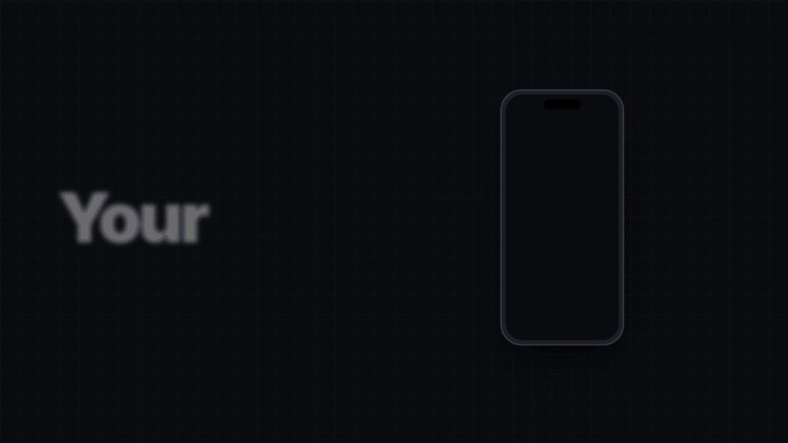

  

  
  
  
  
  

<h3 align="center">Your iPhone, moored to your PC.</h3>

Files, music, a webcam, a second screen and a remote, passed between your iPhone and your Windows PC over your own network. No cloud, no account, no telemetry.

  <a href="https://github.com/atmacafuat/moorline-surumler/releases/latest"><b>Download for Windows</b></a>
  &nbsp;·&nbsp;
  <a href="https://atmacafuat.github.io/moorline-surumler/">Website</a>

  

## Modules

<table>
  <tr>
    <td width="25%" valign="top"> <b>Göz</b> Share a Reel, Short, photo or link from the phone. The PC saves it, transcribes it and turns it into notes.</td>
    <td width="25%" valign="top"> <b>Conch</b> Phone music on PC speakers. Now playing, controls, its own volume, and a tiny overlay that never steals game focus.</td>
    <td width="25%" valign="top"> <b>Wake</b> Drop files either way. Batch sends with per-file progress; only the failed ones retry.</td>
    <td width="25%" valign="top"> <b>Ekran</b> Your iPhone as a second screen.</td>
  </tr>
  <tr>
    <td valign="top"> <b>Kamera</b> Your iPhone camera as the PC's webcam.</td>
    <td valign="top"> <b>Kumanda</b> Launch apps, set the volume, lock the PC from the phone. Every action is off until you allow it.</td>
    <td valign="top"> <b>Sync</b> Clipboard both ways, battery level, phone notifications. All opt-in.</td>
    <td valign="top"> <b>Siri</b> "Open Conch", "Send my last photo to my PC", "Lock my PC".</td>
  </tr>
</table>

## Why it stays out of the way

| | |
|---|---|
| **~3 MB, 0% CPU** | One native app (Rust + Tauri). Idles in the tray at about 3 MB of memory and 0% CPU; the window is fully unloaded when closed. |
| **Local only** | Everything stays on your home network. No cloud, no account, no telemetry. |
| **Nothing auto-starts** | No auto-start, no background updater. Updates are signed and checked only when you ask. |
| **Secure by default** | One-time QR pairing, certificate-pinned TLS, per-device tokens stored only as hashes, signed and replay-protected remote commands, deny-by-default permissions. |

## Install

1. Download `Moorline_x.y.z_x64-setup.exe` from the [**latest release**](https://github.com/atmacafuat/moorline-surumler/releases/latest).
2. Run it and open Moorline.
3. Open the Moorline app on your iPhone and scan the pairing QR code once.

Moorline only installs an update whose signature matches the key built into the app.

## Requirements

- Windows 10 or 11, 64-bit, with WebView2 (included in Windows 11)
- An iPhone with the Moorline app, on the same network as the PC

---

This repository hosts release files and the <a href="https://atmacafuat.github.io/moorline-surumler/">website</a> (<code>docs/</code>). Moorline by <b>optifor</b>.

