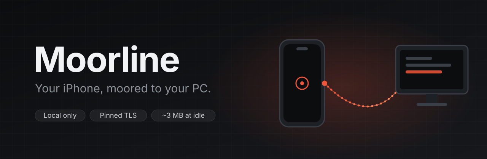

  

  
  
  
  

<b>Moorline</b> ties your iPhone and your Windows PC together over your home network — 
no cloud, no account, no background bloat.

---

## What it does

| | Module | |
|---|---|---|
| 👁 | **Göz** | Share a Reel, Short, photo or link from your phone — your PC saves it, transcribes it and turns it into notes. |
| 🐚 | **Conch** | Your phone's music, on your PC speakers. Now-playing, play/pause/skip, its own volume — and a tiny overlay that never steals focus from your game. |
| 🌊 | **Wake** | Drop files in either direction. Batch sends with per-file progress; only the failed one retries. |
| 🖥 | **Ekran** | Use your iPhone as a second screen. |
| 📷 | **Kamera** | Use your iPhone camera as a webcam. |
| 🎛 | **Kumanda** | Launch apps, change volume or lock the PC from your phone — every action off until you allow it. |
| 📋 | **Sync** | Clipboard both ways, battery level in the corner, phone notifications on your desktop. All opt-in. |
| 🗣 | **Siri** | "Open Conch", "Send my last photo to my PC", "Lock my PC". |

## Built to stay out of the way

- **Tiny.** A single native app (Rust + Tauri). In the tray it idles at **~3 MB of memory and 0% CPU**; the window is fully unloaded when closed.
- **Private.** Everything stays on your local network. Nothing is uploaded, there is no account and no telemetry.
- **Secure by default.** One-time QR pairing, certificate-pinned TLS, per-device tokens (stored only as hashes), signed and replay-protected remote commands, deny-by-default permissions.
- **Nothing starts on its own.** No auto-start, no background updater. You check for updates when you want to.

## Install

1. Download `Moorline_x.y.z_x64-setup.exe` from the [**latest release**](../../releases/latest).
2. Run it, open Moorline and scan the pairing QR with the Moorline app on your iPhone.

Updates are signed: Moorline only installs an update whose signature matches the key built into the app.

## Requirements

- Windows 10 or 11 (64-bit) with WebView2 (included in Windows 11)
- An iPhone with the Moorline app, on the same network as the PC

---

This repository only hosts release files. Moorline by <b>optifor</b>.

